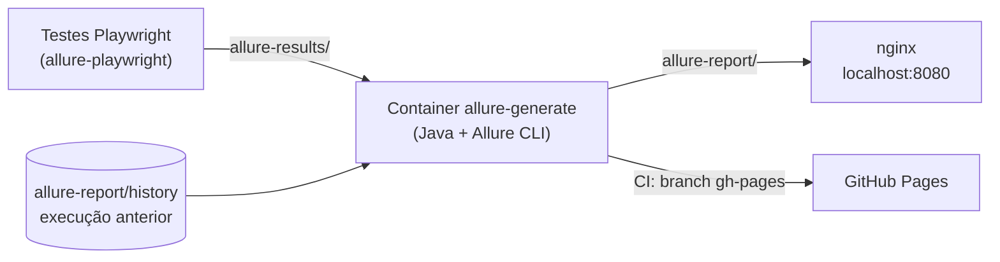
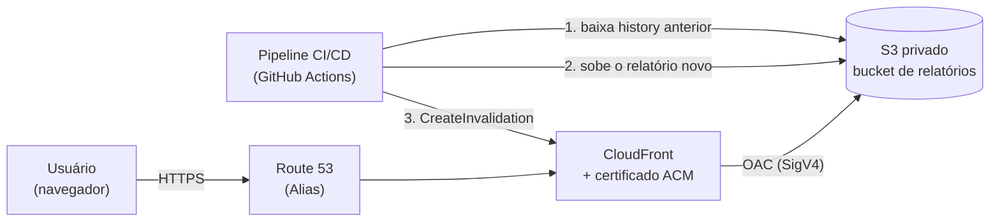

# Allure Report com Playwright e Docker

Projeto de exemplo que mostra como gerar e publicar **relatórios de testes com [Allure](https://allurereport.org/)**,
incluindo **histórico entre execuções** (gráficos de tendência), servindo tudo com **Docker** e publicando
automaticamente no **GitHub Pages** via **GitHub Actions**.

> Relatório online (depois do primeiro run na `main`): `https://<seu-usuario>.github.io/allure-report-docker/`

Os testes são de uma mini API de exemplo (`app/server.js`), criada só para ter o que testar. Não há nenhum
dado, sistema ou credencial real.

## Como funciona



1. O Playwright roda os testes e grava os resultados em `allure-results/`.
2. O script [`scripts/generate-report.sh`](scripts/generate-report.sh) copia o `history` do relatório anterior para dentro dos
   resultados e gera o relatório novo. É isso que alimenta os gráficos de tendência.
3. O nginx serve o relatório (guardado no volume Docker `allure-report`) em `http://localhost:8080`.
4. No CI, o mesmo script roda e o relatório é publicado no GitHub Pages (o histórico fica na branch `gh-pages`).

## Pré-requisitos

- Node.js 20+
- Docker com Docker Compose

Os testes são de API, então **não é preciso baixar navegadores** do Playwright.

## Rodando localmente

```bash
npm ci

npm test            # 1º: roda os testes e grava allure-results/
npm run report      # 2º: gera allure-report/ dentro de um container (mantém o histórico)
npm run serve       # 3º: sobe o nginx em http://localhost:8080
```

**A ordem importa.** O `report` só transforma em página os resultados que o `npm test` já gravou, e o `serve` só
mostra o que o `report` já gerou. Para repetir o ciclo completo com um comando:

```bash
npm test; npm run report && npm run serve
```

(O `;` depois do `npm test` faz o relatório ser gerado mesmo quando algum teste falha, que é justamente quando
ele é mais útil.)

Para parar: `npm run stop`.

### Histórico entre execuções

O relatório e o histórico ficam em um **volume do Docker** chamado `allure-report`, compartilhado entre o container que
gera o relatório e o nginx. Por isso o histórico **sobrevive** quando os containers são removidos (`npm run stop`), e
cada `npm run report` lê o histórico anterior antes de gerar o novo. Como tudo fica no volume, não há problema de
permissão com as pastas do seu computador, e o nginx enxerga o relatório novo sem precisar reiniciar.

Para ver a tendência, rode o ciclo **duas ou mais vezes** (`npm test; npm run report`) e abra o relatório. Na
primeira vez os gráficos de **Trend** aparecem com um único ponto, e a partir da segunda passam a mostrar a evolução.

O histórico só é perdido se você apagar o volume. Para zerar de propósito: `docker compose down -v`.

### Problemas comuns

| Sintoma                                   | Causa                                                                   | Solução                                                        |
| ----------------------------------------- | ----------------------------------------------------------------------- | -------------------------------------------------------------- |
| `Nenhum resultado em 'allure-results'`    | O `npm run report` rodou antes do `npm test`                            | Rode `npm test` primeiro                                       |
| `403 Forbidden` no `localhost:8080`       | O nginx subiu, mas o relatório ainda não foi gerado (sem `index.html`)  | Rode `npm test` e `npm run report`, depois recarregue a página |
| Gráficos de Trend com um ponto só         | Só houve uma execução                                                   | Rode `npm test; npm run report` de novo                        |
| `EACCES: permission denied` no `npm test` | `allure-results/` foi criada como root por uma versão antiga do projeto | `sudo rm -rf allure-results` e rode `npm test` de novo         |

### Sem Docker (opcional)

Precisa de Java instalado:

```bash
npm test
npm run report:local
npx allure open allure-report
```

### Testes que falham de propósito

Um relatório só com testes verdes mostra pouco. Por isso existe [`tests/demo-failures.spec.ts`](tests/demo-failures.spec.ts),
com falhas **intencionais** que só rodam quando você pede:

```bash
npm run test:demo           # roda tudo, incluindo as falhas de demonstração (o comando termina com erro, é esperado)
npm run report && npm run serve
```

Sem `npm run test:demo`, o `npm test` continua todo verde.

| Teste                              | Status no Allure         | Categoria no relatório         | O que mostra                                                    |
| ---------------------------------- | ------------------------ | ------------------------------ | --------------------------------------------------------------- |
| `PUT /items/:id` não implementado  | `failed`                 | Falhas de produto              | Falha de asserção, anexo da resposta, link de issue e dono      |
| Filtro por nome ignorado pela API  | `failed`                 | Falhas de produto              | Diferença entre o esperado e o recebido                         |
| Serviço externo que nunca responde | `broken`                 | Falhas de teste ou de ambiente | Estouro de tempo (timeout), que não é falha de regra de negócio |
| Teste instável                     | `passed` na 2ª tentativa | n/a                            | Tentativas (_retries_): falha na 1ª e passa na 2ª               |

No GitHub Actions, o passo de testes roda com `DEMO_FAILURES=1` e `continue-on-error`, então o relatório publicado
no GitHub Pages já traz as falhas e o job continua verde. **Em um projeto real, remova os dois**: falha de teste deve
reprovar a pipeline.

## Publicando no GitHub Pages

1. Faça push do repositório para o GitHub.
2. Aguarde o primeiro run do workflow **tests-allure** na `main`. Ele cria a branch `gh-pages`.
3. Em **Settings → Pages**, escolha **Deploy from a branch**, branch `gh-pages`, pasta `/ (root)`.

A partir daí, cada push na `main` atualiza o relatório e preserva o histórico. Em Pull Requests o relatório fica como
artefato do workflow, sem publicar.

## Alternativa: hospedar o relatório na AWS (S3 + CloudFront)

O GitHub Pages resolve bem para um projeto público. Em um cenário corporativo é comum hospedar os relatórios na AWS,
com **bucket privado** e **CDN na frente**. Esta seção descreve a arquitetura de referência. Ela **não está implantada
neste repositório** (não há Terraform aqui), serve como guia de como a publicação seria feita.

### Arquitetura



Ideia central: **o bucket nunca fica público**. Só o CloudFront consegue ler os arquivos, usando
**Origin Access Control (OAC)**. O usuário acessa por uma URL HTTPS amigável, e o CloudFront entrega o HTML estático
gerado pelo Allure.

### Componentes

| Recurso          | Papel                                                                           |
| ---------------- | ------------------------------------------------------------------------------- |
| **S3** (privado) | Guarda os relatórios. Com _Block Public Access_ ligado e versionamento opcional |
| **CloudFront**   | Serve o relatório por HTTPS, com cache e compressão (gzip/brotli)               |
| **OAC**          | Dá ao CloudFront permissão de leitura no bucket, sem URL pública                |
| **ACM**          | Certificado TLS para o domínio (para CloudFront precisa ficar em `us-east-1`)   |
| **Route 53**     | Registro Alias do domínio apontando para a distribuição                         |
| **IAM (OIDC)**   | Permite que o GitHub Actions publique sem guardar chaves de acesso              |

Opcional, mas recomendado: uma distribuição por **projeto × branch**, cada uma com `origin_path` próprio, para ter
uma URL por ambiente, por exemplo `https://reports-meu-app-main.example.com`.

### Estrutura no bucket

Cada combinação de app e branch ocupa um prefixo isolado. O CloudFront aponta (`origin_path`) para a pasta `report/`.

```
s3://meu-bucket-allure/
└── meu-app/
    ├── main/
    │   ├── report/      <- servido pelo CloudFront (inclui report/history/)
    │   └── builds/      <- cópias históricas (pode expirar com lifecycle, ex.: 90 dias)
    └── develop/
        ├── report/
        └── builds/
```

### Política do bucket (somente o CloudFront lê)

Troque os valores entre `<>` pelos seus:

```json
{
  "Version": "2012-10-17",
  "Statement": [
    {
      "Sid": "AllowCloudFrontRead",
      "Effect": "Allow",
      "Principal": { "Service": "cloudfront.amazonaws.com" },
      "Action": "s3:GetObject",
      "Resource": "arn:aws:s3:::<BUCKET>/*",
      "Condition": {
        "StringEquals": {
          "AWS:SourceArn": "arn:aws:cloudfront::<ID_DA_CONTA>:distribution/<ID_DA_DISTRIBUICAO>"
        }
      }
    }
  ]
}
```

### Ajustes importantes no CloudFront

- **Default root object:** `index.html`.
- **Erros 403 e 404:** responder com `/index.html` e status 200, porque o Allure é uma aplicação de página única
  e o S3 devolve 403 para caminhos inexistentes em bucket privado.
- **HTTP → HTTPS:** redirecionar automaticamente. TLS mínimo recomendado: `TLSv1.2_2021`.
- **Cache:** um TTL curto (ex.: padrão de 5 min e máximo de 1 h) combina bem com invalidação a cada publicação.

### Fluxo da pipeline

O histórico funciona como no fluxo local, só que a "execução anterior" vem do S3 em vez de uma pasta local.

```yaml
permissions:
  id-token: write # necessário para o login via OIDC
  contents: read

steps:
  - uses: actions/checkout@v4
  - uses: actions/setup-node@v4
    with: { node-version: 22, cache: npm }
  - run: npm ci
  - run: npm test
    continue-on-error: true # o relatório deve ser gerado mesmo com falhas

  - uses: aws-actions/configure-aws-credentials@v4
    with:
      role-to-assume: arn:aws:iam::<ID_DA_CONTA>:role/<ROLE_DO_GITHUB>
      aws-region: us-east-1

  - name: Baixar histórico anterior
    run: |
      aws s3 sync "s3://$BUCKET/$APP/$BRANCH/report/history" allure-report/history || true

  - name: Gerar relatório
    run: ALLURE_BIN="npx allure" bash scripts/generate-report.sh

  - name: Publicar no S3
    run: aws s3 sync allure-report "s3://$BUCKET/$APP/$BRANCH/report" --delete

  - name: Invalidar cache do CloudFront
    run: aws cloudfront create-invalidation --distribution-id "$DIST_ID" --paths "/*"
```

Variáveis como `BUCKET`, `APP`, `BRANCH` e `DIST_ID` podem vir de variáveis do repositório ou de um gerenciador de
segredos (por exemplo, o AWS Secrets Manager).

### Segurança

- Bucket com **Block Public Access** totalmente habilitado.
- Acesso somente via **OAC**, com a policy limitada ao ARN da distribuição.
- **OIDC** no lugar de chaves de acesso de longa duração; a role do pipeline com permissão mínima
  (`s3:PutObject`, `s3:GetObject`, `s3:DeleteObject`, `s3:ListBucket` no prefixo do app e `cloudfront:CreateInvalidation`).
- **Lifecycle** para expirar `builds/` e versões antigas, controlando custo.

### GitHub Pages ou AWS?

|                                       | GitHub Pages                 | S3 + CloudFront                                  |
| ------------------------------------- | ---------------------------- | ------------------------------------------------ |
| Custo                                 | Grátis (repositório público) | Pago por uso (centavos para relatórios pequenos) |
| Configuração                          | Mínima                       | Mais etapas (de preferência com Terraform)       |
| Acesso privado / por empresa          | Não é o foco                 | Sim, bucket privado e controle por IAM           |
| Domínio próprio e múltiplos ambientes | Limitado                     | Flexível                                         |
| Indicado para                         | Vitrine, projetos pessoais   | Ambientes corporativos                           |

## Estrutura

```
.
├── app/server.js                    API de exemplo (Node, sem dependências)
├── tests/                           testes Playwright com anotações Allure
├── playwright.config.ts             reporter allure-playwright + servidor da API
├── categories.json                  categorias de falha exibidas no relatório
├── scripts/generate-report.sh       gera o relatório e preserva o histórico
├── Dockerfile                       Java + Allure CLI
├── docker-compose.yml               allure-generate (gera) e report (nginx)
└── .github/workflows/tests-allure.yml
```

## O que os testes demonstram no relatório

- Organização por **epic / feature / story** e **severidade**
- **Steps** nomeados e **anexos** (JSON)
- **Parâmetros** em testes gerados em loop
- Testes **skipped** e `fixme`
- Falhas de verdade: `failed`, `broken` (timeout) e teste **instável** com tentativas
- **Categorias** de falha e **informações de ambiente**
- **Tendências** entre execuções

## Tecnologias

Playwright · TypeScript · Allure Report · Docker / Docker Compose · nginx · GitHub Actions · GitHub Pages ·
AWS (S3, CloudFront, ACM, Route 53, IAM OIDC) como arquitetura de referência

## Licença

[MIT](LICENSE)
